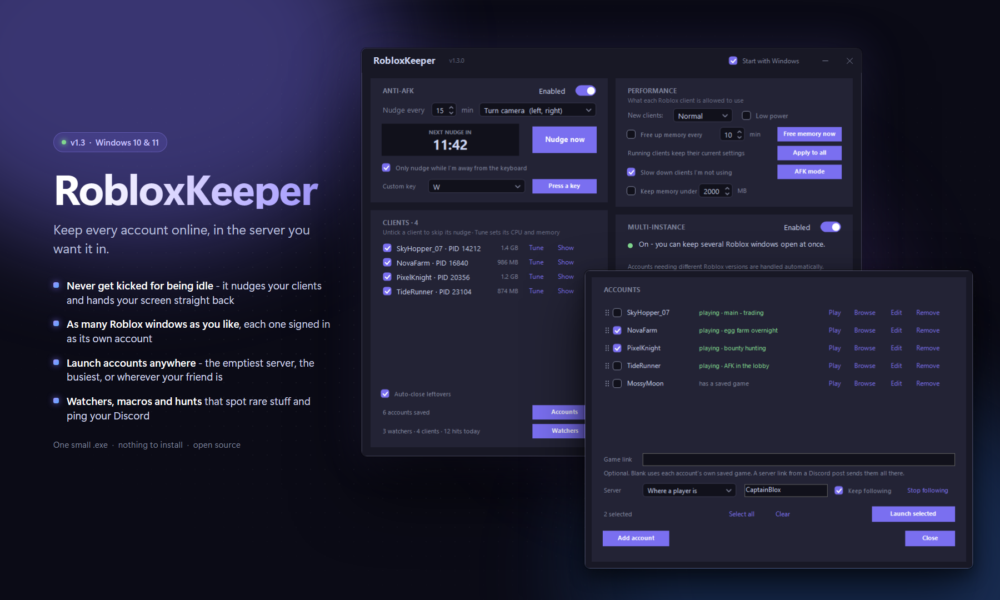

# RobloxKeeper

**Keep your Roblox accounts online, run as many as you like, and send them where you want.**

A small Windows app that sits in your tray and looks after your Roblox clients. It stops the
20-minute idle kick, lets you open several Roblox windows at once, launches any of your saved
accounts straight into a game, and can keep an eye on the screen for you. One `.exe`, nothing
to install.

[](https://github.com/VladDerK1ng/RobloxKeeper/actions/workflows/build.yml)
[](https://github.com/VladDerK1ng/RobloxKeeper/releases/latest)


<p align="center">
  
</p>

## Download

Grab `RobloxKeeper.exe` from the **[latest release](https://github.com/VladDerK1ng/RobloxKeeper/releases/latest)**
and run it before you open Roblox. That's all. It keeps itself up to date after that, and asks
before it installs anything.

You need Windows 10 or 11 and the normal Roblox from roblox.com. The Microsoft Store version of
Roblox isn't supported.

## What it does

**A home for your games**
- Opens on a Home page: the Roblox windows you have open, the games you played last, your
  favourites, and what's popular - click one and pick which account plays it.
- Search Roblox's games, see which friends are online and join them, and save screenshots.
- No adverts, no sponsored games, no account with us, and no server of ours: everything is
  kept on your PC, and the only thing it talks to is Roblox itself.

**Keeps you online**
- Nudges each Roblox window every few minutes so you never get kicked for being idle, then hands
  your screen straight back. That works even when the games are on another virtual desktop.
- Waits until you've stepped away from the keyboard, and never interrupts a fullscreen game.
- You pick what it presses: turn the camera, zoom, jump, take a step, jiggle the mouse, or any
  safe key you like.

**Runs lots of accounts**
- Open as many Roblox windows as you want, each signed in as a different account.
- Save your accounts once, then launch one or a whole group with a click. No signing out, no
  pasting links.
- Send them to any server, the emptiest or the busiest ones, all into the same server,
  straight into a friend's server, or into a private server from its link. Tick *Keep following* and they'll go after that friend every
  time they switch servers.
- Every account gets its own browser, in dark mode, for finding games and joining friends.

**Watches the screen for you**
- Watchers spot a word, a chat message or a picture on any client, even behind other windows,
  and ping you on Discord with a screenshot and a link back into that server.
- Macros replay keys, clicks, drags and chat messages - and can **click a picture wherever it is
  on screen**, wait for one, and repeat until you stop them. Rules run them when a watcher finds
  something, on a timer, on a hotkey, or when a client joins a server.
- **Quick Record**, like TinyTask: record anything you do on your screen and play it back - once,
  a few times or until you stop it, at half, normal, double or four times the speed. No Roblox
  window needed. Save a recording as a macro to keep it.
- **A key on every macro**, like MacroGamer: press it to play the macro once, to start it and
  press again to stop, or hold it to keep it playing. Macros can play on a Roblox window or
  anywhere on your screen.
- An autoclicker, on the client you're playing or on several clients taking turns.
- Hunt mode moves accounts from server to server until a watcher finds what you're after.

**Easy on your PC**
- Lower priority and low power mode for the clients you're not playing, and a memory limit for
  the ones sitting in the background.
- Cleans up the leftover Roblox processes that pile up after you close games.
- Can start with Windows, ahead of other startup apps, so it's ready before any Roblox window
  opens.

## New in 1.4

- **A launcher.** A strip of pages down the left: **Home** (your open Roblox windows with a live
  picture of each, the games you played last, favourites, what's popular now), **Games** (Roblox's
  own lists, and search), **Friends** (who is online, where, and Join), **Automation** (every tool
  by name with a line saying what it's for), **Screenshots**, and **Keeper** - the window as it
  always was, unchanged. Click a game and choose which account plays it.
- **Start here.** Home opens with the jobs people come for - add an account, stop the idle kick,
  click something over and over, record a macro - each one click away. Hide it when you know
  your way round.
- **Text that fits.** Under a Windows custom scaling level - 125%, say - text was drawn a quarter
  bigger than the windows were laid out for: labels ran out of their rows and the title wrapped.
  Text is now drawn at the size the windows were designed around, so everything fits. The windows
  are not scaled up with the display: at 125% they are the size they would be at 100%.
- **Looks.** Graphics settings Roblox allows to be set from a file - smoother edges, quality
  level, grass, display scaling - chosen from plain lists; and **mod packs** that replace fonts,
  cursors, sounds, sky and textures, from a folder or a zip (packs made for Bloxstrap work). The
  original of every replaced file is kept, a new Roblox version gets your looks put back on it by
  itself, and **Put Roblox back** undoes all of it. Off until you use it.
- **Shaders, without touching Roblox.** Looks > Shaders lays a see-through window over the game
  that shows the game itself drawn through a shader - sixteen looks, from sharper and more vivid
  to soft glow, golden hour, comic book, old film and night vision - at three strengths, or
  **your own `.hlsl` file**. Nothing is loaded into Roblox; clicks and keys go straight through
  to the game. New, and not yet tried on many PCs.
- **Ready-made pointers.** Looks > Mod packs > *Add a pack* has seven mouse pointers that come
  with the app - crosshairs, dots, a ring, a scope, a big bright arrow - drawn by the app itself,
  so there is nothing to download. *Not yet seen inside Roblox.*
- **Macros as text.** *Write it as text* in the macro editor shows the steps as lines -
  `press E`, `wait 2`, `click picture "Buy" wait 3`, `repeat forever` ... `end` - to type, change,
  copy out and paste in. It is the same macro as the one made with the buttons, and a wrong line
  says which line and what it expected.
- **A guide to making your own.** [MODDING.md](MODDING.md) - also behind *How to make one* in
  the app - explains mod packs, shader looks and macros as text for someone who has never made
  one, with examples to copy. Every example in it is run by the tests.
- **Screenshots.** A key of your choice saves a picture of the Roblox window you're in to
  `Pictures\RobloxKeeper`. Nothing is uploaded.
- **Click a picture, wherever it is.** A macro step that looks at the client as it plays and
  clicks the picture where it is right then - a button that moves, an egg that spawns somewhere
  new. It can wait for the picture to turn up first, and either skip it or stop the macro if it
  never does. **Wait for a picture** does the same without clicking: until a shop has opened, or a
  loading screen has gone. A picture watcher can now **click what it found** with no macro at all.
- **Repeats.** Put steps in a repeat: a number of times, until a picture shows or goes, or
  **until you stop it**. A macro that repeats until stopped has no one-minute limit - it steps
  aside whenever the anti-AFK nudge or another macro needs the keyboard, then carries on.
- **A stop key.** F10 stops everything that is playing, at once, and lets go of every key. It is
  only taken while something is playing, and you can change it in Macros. A key rule that starts
  a repeating macro stops it when you press the key again.
- **Keys still reach the game.** The autoclicker key, the screenshot key, rule keys and macro
  keys are heard without being taken away, so F6 still does whatever it does in Roblox. Pick keys
  the game doesn't use. Only the stop key is taken, and only while something is playing.
- **Autoclicker.** Left or right button, a speed picked by name (or your own), where the mouse
  is, at one spot you **pick by clicking it on a picture of the game**, or on a picture. The
  window only shows the rows your answers need. Once you have set it up, F6 switches it on for the client in front. Or
  set it to take turns over several clients, each brought to the front for its few seconds.
- **Play, on every macro.** Each macro's row has **Play**: now, on every Roblox window or on one
  of them - or by itself, when you press a key, every few minutes, when a watcher finds something
  or when a window joins a game. Picking one opens the rule already filled in (a free key, every
  client), so *press a key and it plays on all of them* is two clicks. The row then says what
  starts it.
- **Start from an example.** Macros > *Start from an example* opens a ready-made macro to change
  and save: jump every few seconds, click one spot over and over, click a picture whenever it
  shows up, hold a key down.
- **Pick it on the game.** A click, move, scroll or drag step no longer needs percentages typed:
  press the button and click the spot on a picture of your game. The numbers are still there.
- **Macros and Autoclicker in the tray menu**, so they are two clicks away.
- **Drags, scrolling and pointer moves** as macro steps. Recording keeps drags and the wheel, and
  pointer movement too if you tick it.
- "Only while I'm away" and the nudge now go by when *you* last touched the keyboard or mouse,
  not by the keys a macro is pressing.

## New in 1.3.3

- **Every client shows its own account, even when you launch a whole group at once.** Launching
  several accounts together could leave some clients called *Client 2*, *Client 3* while another
  took the wrong account's name. From there an account could look like it wasn't playing, so
  launching it again signed its own client out, and moving or hunting with one could close a
  different account's client. RobloxKeeper used to work out which Roblox log belongs to which
  client from the time in the log's name, and clients launched a few seconds apart all looked
  alike. It now asks Windows which client has each log open, which is exact.

## New in 1.3.2

- **No more antivirus false alarms from updating.** The updater used to install new versions with a
  hidden batch script, which some antivirus programs took for a trojan. It now checks the download
  against the checksum published with the release and swaps it in without any script.
- The exe now says what it is in *Properties > Details*: name, version, author and licence.

## New in 1.3.1

- **Join private servers from a link.** Paste the link a private server's owner shared into the
  Accounts window - the current `roblox.com/share?code=...` kind or the older
  `privateServerLinkCode` kind - and the ticked accounts go straight into that server. An account
  that's already playing is moved there. You can also save a private server link as an account's
  own game with Edit, so Play always takes it there.

## New in 1.3

- **Choose where accounts join.** Emptiest or busiest servers, all in one server, a friend's
  server, or a server link pasted from a Discord alert. *Keep following* moves them after that
  friend whenever they change servers.
- **No more freezing.** Clients started by RobloxKeeper could freeze for several seconds at a
  time. Launches now look exactly like the website's, and clients always get every CPU core.
- **Every client shows the right account name**, however it was started.
- **Drag things into order.** Accounts, macros, macro steps, rules and watchers all have a handle
  to drag, and a right-click menu to move or copy them.
- **The Accounts window got nicer.** Launching no longer freezes it, it shows who's playing, and
  it remembers what you had ticked.
- **Dark mode** in the account browser, plus a Friends button.
- **The memory limit is a real limit now**, instead of emptying clients over and over. Performance
  settings are checked every half minute and put back if something else changed them.
- **Back to your own desktop** after a nudge or a macro, when your games are on another virtual
  desktop.
- Scrolling over a dropdown or number box no longer changes it by accident.
- Disconnect protection is gone. The long-session disconnects it was built for were most likely
  just the internet, and it was one more thing touching Roblox.

## Is it safe?

RobloxKeeper stays completely outside Roblox. It doesn't inject anything and doesn't read or
write the game's memory. It works through Windows itself: the same keyboard and mouse input a
real keyboard makes, screenshots of the window, and Roblox's own website launch.

It changes none of Roblox's files either - **unless you ask it to on the Looks page**, which is
off until you use it. Looks writes graphics settings Roblox itself allows into a small settings
file, and can replace fonts, sounds and textures with a pack; it keeps the original of every
file it replaces, and one button puts Roblox back exactly as it was installed. Your saved logins are encrypted for your Windows user and never go anywhere but
roblox.com. Details are in [How it works](#how-it-works) and
[Byfron / Hyperion compatibility](#byfron--hyperion-compatibility).

That said, automation and running several clients are against the
[Roblox Terms of Use](https://en.help.roblox.com/hc/en-us/articles/115004647846). Use it at your
own risk.

## Everything it does, in detail

<details>
<summary>Every feature, with the fine print</summary>

| | |
|---|---|
| **Anti-AFK** | Nudges every selected Roblox client on a timer (default 15 min, adjustable 1-19) so the 20-minute idle kick never fires. Briefly focuses each client, sends the input, and returns focus to whatever you were doing - and to your own **virtual desktop**, when the clients are on another one. Minimized clients are restored, nudged, and re-minimized. The countdown only runs while a selected client is actually open. |
| **Nudge methods** | Choose what the nudge sends: **Zoom out + in** (`O`, `I`), **Turn camera** (`←`, `→` - default), **Jump** (`Space`), **Step forward + back** (`W`, `S`) for games that check the character actually moved, **Mouse jiggle** for games that ignore the keyboard, or **Custom key** - picked from a list or captured by pressing it. Every two-part method sends a movement and its opposite, so a client parked for eight hours ends where it started. Keys that open chat or a menu, move focus, or stick down as a modifier are refused, including ones you pick yourself: this fires unattended, and a stray key goes into a live game. |
| **Never interrupt you** | A nudge has to take the foreground - Roblox only counts input delivered to the focused window, which is measured, not assumed. So the goal is for it to cost as little as possible. Each client is held for **230-430ms**, not the ~1.4s it used to be. With **Only nudge while I'm away** on (the default) it waits for a five-second lull first, and a **fullscreen window in front is protected outright** - a game counts as being played even after ten minutes without a keypress, which is exactly the case `GetLastInputInfo` alone cannot tell from being away from the desk. The one override is a client within a minute of Roblox's 20-minute idle kick: then it nudges anyway, after a tray warning, because losing the account beats losing a round. |
| **Per-client selection** | Every running client appears as a row in the Clients panel (scrollable, so any number of clients works). Untick one and the nudger leaves it alone - run anti-AFK on two accounts while a third stays untouched. **Show** brings that client's window to the front so you can tell which is which. New clients default to enabled. |
| **Launch handler repair** | Windows launches Roblox through the `roblox-player://` registration, and Roblox rewrites it whenever it switches versions. If it ends up pointing at a version folder that is no longer installed, every Play click runs a missing executable, Roblox's installer fires to repair the install, and **that installer closes every open client** - which reads as clients closing at random while Roblox seems to update over and over. Nothing used to check the target existed. Now it is checked every second, named in the Activity log, and **Repair** points it back at an installed version. Found live on a real machine with both `roblox-player` and `roblox` dangling. |
| **Multi-Instance** | Holds Roblox's `ROBLOX_singletonMutex` (and `ROBLOX_singletonEvent`) so multiple clients can run simultaneously. A dedicated thread queue-waits on the mutex the same way Roblox clients do, so ownership transfers to RobloxKeeper at the kernel level the instant it frees - a launching client can never win the race. If clients already own it, one click on **Close all Roblox** clears them (ghost processes included) and takeover is immediate. |
| **Client monitor** | Live count of open Roblox clients with each one's memory use, plus detection of window-less "ghost" Roblox processes (they can silently block multi-instance) with a one-click **Close leftovers** button. Roblox's own tray process - the window-less one it relaunches with `--launch-to-tray` when you close a client - is recognised as such and shown as *in tray* rather than *stuck*. Roblox starts one for every client closed and never ends them, so once one has sat idle for 150 seconds **Auto-close leftovers** closes it too. Processes still starting up are shown as *starting* rather than *stuck*, so a normal launch never looks like a fault. |
| **Per-client resources** | Each client row has a **Tune** link: set its **CPU priority**, switch on **efficiency mode** (EcoQoS - the same throttling as Task Manager's), or **trim its memory** on the spot. Every client always runs on **every core**: locking a Roblox client to a few cores starves its ninety-odd threads and freezes it for seconds at a time, so there is no core setting, and a client an older version locked is put back on every core. |
| **Throttle what you aren't using** | **Slow down clients I'm not using** drops every background client a priority step and puts it in efficiency mode, restoring it the moment you switch back. **AFK mode** is the one-click version: everything parked except the client in front of you. **Keep memory under N MB** holds every client you aren't using at or under that much - a hard working-set limit, so Windows moves out what the client has used least, a little at a time, instead of emptying it all at once - and lets the client in front of you use what it needs. There is deliberately no FPS cap: Roblox has its own Maximum Framerate setting, up to 240, and nothing higher is supported by Roblox - the frame-rate flag launchers used to write is no longer on the list Roblox honours. |
| **Client defaults + auto-trim** | The **Performance** card sets the profile every newly launched client gets, so the foreground account can outrank the AFK ones without touching anything per-launch. Clients already running keep what they started with - the account you are playing is never retuned behind your back - and **Apply to all** is there when you do want everything changed at once. Each client's priority and low power are read back every half minute and put back if anything else has changed them, and a client found locked to fewer cores is given every core again. **Auto-trim** hands idle memory back to Windows on a timer, skipping whichever client you're actually looking at. **Free memory now** does it immediately, from the window or the tray menu. |
| **Account manager** | Roblox stores five accounts and makes you sign out to switch. This stores as many as you like. **Add account** opens Roblox's own login page in an embedded browser - you type your own credentials into Roblox's page, solve Roblox's own CAPTCHA and handle your own 2FA; nothing here reads a password, fills a login form or works around a CAPTCHA. Each account gets its **own browser profile**, so each stays signed in on its own. Every launch sends the device's own browser tracker, as the website does - sending each account its own made Roblox 0.740 clients freeze for seconds at a time. **Launch** puts any account straight into a game by asking Roblox for a launch ticket, exactly as pressing Play on the website does - one, or the ticked ones, a few seconds apart, without the window freezing. Choose **where they join**: any server, the **emptiest** or the **busiest** (each its own, or **all in the same server**), **where a player is** - found by name and asked with each account's own sign-in, so it follows that player's privacy settings - a **server link** pasted from a Discord post, or a **private server link** - the share link its owner made, resolved the way roblox.com does it. **Keep following** moves them after that player whenever they change server; stop it from the window or the tray. An account already playing is left alone unless it is being sent somewhere in particular, and then its old client closes only once the new one's ticket is in hand. Drag accounts into the order you like; rows say **playing** while an account has a client open, and the window remembers who was ticked. **Browse** opens Roblox in that account's browser, in Roblox's own **dark theme**, with Home, Games and Friends. Every client is named after the account **Roblox's own log** says it is signed in as, however it was started. |
| **Where credentials live** | `%APPDATA%\RobloxKeeper\accounts.dat`, encrypted with DPAPI at CurrentUser scope - Windows ties the key to your user on this machine, so the file is useless if it is copied anywhere else. A `.ROBLOSECURITY` cookie IS the account: hold one and you are signed in as that user, no password involved. Nothing is sent anywhere except to roblox.com, and no code path prints a cookie to the log, a tooltip or an error message. Removing an account deletes its stored session and browser profile from this PC. |
| **Watchers** | Get told when something turns up on a client's screen: a **word** (say, *spawned*), a **new chat line** (you get the whole line, not just the word), or a **picture** you cut out of the game with its background painted out. Each watched client is looked at up to four times a second **without being focused, clicked or typed into** - it works behind other windows and on another virtual desktop, though not while minimized, and the Watchers window says which clients can't be read and why. You're told on **Discord** (with the picture and a link straight back into that server), with a **pop-up**, a **sound** or a line in the activity list - chosen per watcher. Draw a **box** around the part of the screen that matters and it is read about nine times faster than the whole window; boxes belong to a game, so every client in that game uses them. **Test against client now** shows exactly what was read, or how alike a picture was, before you rely on it. Keep a **setup** of watchers for each game - one for Steal an Egg, one for another game - and switch between them in one click from the main window; every watcher swaps at once, and the chat already on screen is not sent again. |
| **Where watchers live** | `%LOCALAPPDATA%\RobloxKeeper\watchers.dat`, encrypted with DPAPI like the account list: the Discord webhook link in it is enough for anyone who has it to post into your channel, so it is never shown or logged either. Setups are kept in the same file; the webhook link is shared by all of them, and a watcher can have a link of its own. The pictures watchers look for are ordinary PNG files in `%LOCALAPPDATA%\RobloxKeeper\templates` - open the folder and look. |
| **Home** | The first page. **Open now** shows every Roblox window with a small live picture (taken the way watchers take theirs - never while the window is minimized - and only while Home is on screen), whose account it is and how much memory it uses; click one to bring it forward. **Continue** is the games you played last, read from the join lines Roblox writes in its own log, so it works for any client, signed in to any account. **Favourites** are the chosen account's. **Popular right now** is Roblox's own list. Click a game for a menu: play as the chosen account, as another, with all of them, or open its page. With no account saved it still shows your windows and Roblox's lists. |
| **Games** | Roblox's own lists of games - trending, most played, and the rest - a row each, opened out with *See all*, and a search box. Anything Roblox marks as sponsored is left out. |
| **Friends** | The chosen account's friends: online first, in a game before on the website. **Join** takes that account to a friend's server when Roblox says which one it is - their privacy settings decide that. Asked again once a minute, and only while the page is on screen. |
| **Automation** | Autoclicker, Macros, Watchers, Rules, Hunt and Stop everything as six tiles, each with a line saying what it is for and what it is doing now. The tools themselves are unchanged. |
| **Screenshots** | Choose a key on the Screenshots page; pressed, it saves a PNG of the Roblox window in front (or every open one, if none is) to `Pictures\RobloxKeeper`, named by date, time and account. The page shows the newest sixty; click one to open it. |
| **Looks: graphics** | *Built and tested against a pretend Roblox folder; not yet tried on a real install, so which of these Roblox actually honours today is unconfirmed.* Roblox honours a published list of eighteen settings in `ClientSettings\ClientAppSettings.json` and ignores every other; getting round that list is what Roblox acts against, so this app refuses to write anything that isn't on it. The page offers the ones that change how the game looks, in plain words: **Smoother edges** (anti-aliasing off, 2x, 4x, 8x), **Graphics quality** (Roblox's levels 1 to 21, by name), **Grass** (none, close by, far), and **Don't let Windows stretch the game**. Texture quality is on Roblox's list but the current client no longer contains it, so it isn't offered. Anything else already in that file - your own edits - is left exactly as it was. Written to every installed Roblox version; read by Roblox when a game starts. There is no DLSS, ray tracing or injected shader here: those need the game engine or code inside the game, and Roblox's anti-tamper blocks the second. |
| **Looks: mod packs** | *Tested against a pretend Roblox folder, not yet on a real install.* A pack is a folder or zip laid out like a Roblox version folder. Only `content`, `ExtraContent` and `PlatformContent` are accepted; programs and scripts, links, and paths that climb out of the folder are refused, and one bad entry refuses the whole pack. Packs are kept in `%LOCALAPPDATA%\RobloxKeeper\mods`; tick the ones you want, put them in order (a later pack wins where two replace the same file), and press **Apply packs**. Before a file is replaced for the first time its original is copied to `%LOCALAPPDATA%\RobloxKeeper\backup`, and never overwritten after. Unticking a pack and applying puts its files back. **Files** on a pack's row lists what it would replace or add, and which of them a pack lower in the list takes instead, before anything is applied. A pack that is only ticked is never put into Roblox by itself: what a new Roblox version is given is what **Apply packs** was last pressed for. **Ready-made**: *Add a pack* lists seven mouse pointers the app draws itself when you pick one (two crosshairs, two dots, a ring, a scope, a big arrow) - no pictures are carried in the exe and nothing is downloaded. They replace `ArrowCursor.png`, `ArrowFarCursor.png` and, except the arrow, `MouseLockedCursor.png`; only one is ticked at a time, since they replace the same files. A game that sets its own pointer keeps its own. *Not yet seen inside Roblox.* |
| **Looks: shaders** | A shader overlay: for each Roblox window, a separate copy of this exe opens a borderless window exactly over the game, takes a live copy of the game's picture with Windows' own window capture (what a screen recorder uses), runs it through a pixel shader on its own Direct3D device, and shows the result. The overlay never takes a click, a key or the foreground - they pass through to the game, which stays the window in front, so macros and the nudge work as before - and it is only shown while that game is the window in front. **Built-in looks**: Sharper, Vivid, Sharper and vivid, Warm evening, Cinema, Cool and clean, Black and white, Crisp HD, Soft glow, Golden hour, Dreamy pastel, Deep shadows, Comic book, Old television, Old film and Night vision, each Gentle, Normal or Strong. A look reads the game's picture 5 times a pixel, or 13 for the three that glow; the nine newest were drawn over a test window at Normal strength only. **Your own**: *Make my own...* opens `%LOCALAPPDATA%\RobloxKeeper\shaders` with an `example.hlsl`; a copy under another name appears in the list, and a mistake in it is reported in the compiler's own words. Choosing *Off* ends the overlays. Measured over a test window on a 180Hz laptop with integrated graphics: every frame shown (166 a second), 0.4ms after it arrived, for about 10% of one processor core, 5% of the graphics card and 60-70MB a window. Real delay is at least one screen refresh on top and was not measured. Needs Windows 10 1903 or newer. What it cannot do is anything that needs more than the picture - DLSS, ray tracing, depth of field, ambient occlusion. Not tried with HDR or across two monitors, and not yet run against a live Roblox window. |
| **Macros as text** | *Write it as text* in the macro editor shows the steps one to a line - `press E`, `hold W`, `wait 2`, `click 50 50`, `click picture "Buy" wait 3 or stop`, `say "hello"`, `repeat forever` ... `end` - and reads them back. It is another way to write the same steps, not a programming language: anything the editor refuses is refused here in the same words with the line's number, and nothing is kept until every line is understood. Pictures and boxes are named, not carried: a macro sent to someone else names pictures they cut and boxes they draw themselves, and the app says which are missing. Nothing in it runs inside Roblox. |
| **The modding guide** | [MODDING.md](MODDING.md) is carried inside the exe. *How to make one* (Looks) and *Every word it knows* (the text window) write it to `%LOCALAPPDATA%\RobloxKeeper\How to make mods.html` - a page with no script in it that fetches nothing - and open it in your browser. The tests run every macro, every table line and every shader in it. |
| **Looks: the way back** | **Put Roblox back** restores every original, deletes anything a pack added, removes the settings this app wrote, and switches every pack off. It is safe to press twice, and works even if a pack has since been deleted. When Roblox installs a new version, your graphics settings and the packs **Apply packs** was last pressed for are put onto it within a minute, and the activity list says so. A file a running client has open can't be changed: the page says to close Roblox and try again. |
| **Pages cost nothing until opened** | A page is built the first time you go to it, and does nothing while the window is in the tray or another page is showing: no sign-in is read, nothing is asked of Roblox, no timer runs. Game icons are kept on disk for a week and at most 96 in memory, and those are let go when the window is hidden. |
| **Macros** | A few keys, clicks, waits and typed text played on a client - **recorded** by doing it once in the game (F8 to stop; only what you do in that client is seen) or built step by step. Typing can **say it in chat** - open the chat with `/`, type, and send with Enter - in one step. Clicks are kept as a place on the window, so they land on the same button at any size. The client comes to the front while a macro plays and whatever you were using comes back after; if another window comes to the front part-way it stops at once and lets go of any key it was holding. A macro on a Roblox window can't be longer than a minute, unless it repeats until stopped (below); one that plays **anywhere on your screen** can run for 30 minutes. Every list - macros, their steps, rules, watchers, accounts - has a **grip** at the start of each row: drag it into any order, or right-click it to move a row to the top or bottom or **make a copy**. |
| **Steps that look at the screen** | **Click a picture** finds a picture on the client at the moment the step plays - after the client has come to the front, never from an earlier sighting - and clicks its middle, or a set distance from it. It can wait up to a time you choose for the picture to turn up; if it never does, the step is skipped, or the macro stops, as you choose. **Wait for a picture** waits for one to show or to go. Pictures are cut out of a client and can have their background painted out, exactly as a picture watcher's are, and a watcher's picture can be reused. **Look for it now** says how alike it is on every open client. Whole-window looks take about a fifth of a second each. |
| **Other steps** | **Move** the pointer, **drag** from one place to another with either button - a right-drag turns the camera, and the same drag turns it the same amount each time - **scroll** the wheel, and **click wherever the pointer already is**. Recording keeps drags and the wheel; pointer movement between clicks is kept, as a place every tenth of a second, only if you tick *Mouse movement too*. A first-person or shift-locked camera reads the mouse differently and can't be replayed from a recording of pointer places. |
| **Repeats and sessions** | A **repeat** plays the steps down to its *End of repeat* again: a number of times, until a picture shows, until a picture has gone, or until stopped. Repeats can sit inside repeats, three deep. A macro with a repeat that only stopping it or a picture ends is a **session**: it has no one-minute limit. Between steps it gives the keyboard to the anti-AFK nudge the moment the nudge asks, letting go of any held key and pressing it again when it gets its turn back; with other macros waiting it plays for five seconds and lets the next one in. It still only ever plays on the window in front, and still stops the moment another window is brought there. |
| **Stop key** | One key - **F10** unless you change it in Macros - stops every macro and the autoclicker at once, clears whatever was waiting to play, and lets go of every key and mouse button. Windows is only asked for the key while something is playing, so F10 is every other program's the rest of the time. Stop is in the tray menu too. A rule on a key that starts a session stops it on the next press of the same key. |
| **Autoclicker** | Tray icon > Autoclicker, or Macros > Autoclicker. Each choice is a list of plain answers, and a row is only shown while the answer above it needs it. Speed is picked by name - slow (1 a second), normal (5), fast (10), very fast (20) - or typed as your own. **One spot** is chosen with **Pick it on the game**: a picture of the client opens and you click the spot. Left or right button; the gap between clicks, from 0.02 seconds; **where the pointer is**, at **one place** on the window, or **on a picture** each time it is found. On **the client in front**: bring the client forward and press **F6** (changeable, and only listened for once you have saved the autoclicker) - your pointer is left alone and holding Shift or Ctrl doesn't stop it. Or on **several clients, taking turns**: each ticked account's client (or every client) is brought to the front for a few seconds of clicking, then the next - this takes over the PC while it runs, so it is for when you're away. It is a session like any other: the stop key, another window in front, or F6 again ends it. Clicks go out at the pace asked - measured on a live client, one every 22-23ms when asked for 20ms and every 53ms when asked for 50ms. Whether a game counts every one is up to the game: a toggle button with an animation missed some at ten a second and none at five. |
| **Then play a macro** | Any watcher can play a macro on the client that saw it - buy the egg that just spawned, say. A picture watcher can instead **click the picture, where it was found**, with no macro to make. At most once every 15 seconds on each client, one macro at a time, and never at the same moment as an anti-AFK nudge. |
| **Rules** | For everything else, a rule plays a macro **when you want**: when a watcher finds something (any watcher or one by name, and only if what it found has certain words in it), **every** so many seconds, minutes or hours, when you **press a key** (F1-F12 or the number pad, with Ctrl, Alt or Shift), or when a client **joins a server**. It plays on the client it happened on, the client in front, every client or the accounts you pick - a number of times in a row, after a wait if the game needs one, at most once every so often, and if you like only while you're away from the keyboard. Rules belong to a setup, so a timer for one game never fires in another. |
| **Hunt mode** | Pick accounts and a game: each account's client is moved to a server of that game, the watchers of the setup in use look for as long as you set, and it moves on - until a watcher finds something, and then it **stays in that server**. Choose **any server, the emptiest or the busiest** - quiet ones for something anyone can take, busy ones for a bounty to hunt - and optionally how many players. Servers are picked from Roblox's public list: never the one it is in, one visited in the last half hour, or one another of your clients is in. A move gets the server list and a launch ticket first and only then closes the client, so a failed move leaves it where it was. Accounts move one at a time, so two never pick the same server. Stop it from the Hunt window or the tray icon. For accounts saved in the account manager. |
| **Same size windows** | **Same size as Client 1** in the Watchers window makes every client the size of the first, so a box drawn on one - or a click recorded on one - lands exactly on all of them. Windows are sized from outside, as dragging an edge would; nothing in Roblox's files is changed. |
| **Single instance** | Launching RobloxKeeper while it's already running won't open a second copy - it surfaces the existing window instead, restoring it from the tray if needed. |
| **Start with Windows** | Optional autostart toggle (top-right). With it on, RobloxKeeper starts **minimized to the tray** the moment you sign in and holds the mutex before any Roblox client can exist, which makes the launch-order problem impossible. It starts the way Wallpaper Engine's high-priority start does - a Task Scheduler task with a sign-in trigger, at normal priority, instead of the Run list, which Windows reads only once the desktop has loaded and after a deliberate delay - so it is ahead of other startup apps. No administrator rights are needed, it has no time limit and runs on battery, and a copy started twice at sign-in never pops its window open. If Task Scheduler says no, it falls back to the Run list. |
| **Saved settings** | Every setting - anti-AFK on/off, interval, nudge profile, multi-instance, auto-clear ghosts, client defaults, auto-trim - is written to `%APPDATA%\RobloxKeeper\settings.txt` and restored on the next launch. Per-client **Tune** overrides are deliberately session-only: Windows recycles PIDs, so a saved override would eventually land on an unrelated process. |
| **Diagnostic log** | Every client open/close is logged with the reason, naming a **singleton kill**, the **Roblox bootstrapper**, or a normal close. **Copy log** puts the whole thing plus your version, Windows build, settings, and Roblox launch path on the clipboard for sharing. |
| **Launch-path check** | Warns at startup if Roblox launches via the legacy bootstrapper (`RobloxPlayerLauncher`), which closes running clients on every launch no matter who holds the mutex - the one failure mode multi-instance cannot fix from outside. |
| **Different versions per account** | Roblox does not give every account the same client version, and it reinstalls to switch - an installer that closes every open client. RobloxKeeper spots the account that is mid-launch, reads its join URL, stops the installer, and starts that account **directly on the version it needs**. No reinstall happens, so your other clients are never touched. Fully automatic, any number of accounts, nothing to configure. |
| **Update shielding** | A background Roblox update that would close your clients is held back while you are playing, and installs by itself once you close them all. |
| **Auto-close leftovers** | Leaked Roblox processes are ended automatically once their window has been gone for 150 seconds *continuously*. Showing a window at any point resets that clock, so a client that briefly reports no window - during a place teleport, a fullscreen switch, or its own shutdown - is never touched. The measurement is deliberately not "process older than 150s", which would leave a long-running client with no grace at all. A leaked client wastes a gigabyte of RAM whether or not multi-instance is on, so nothing else gates this. Roblox also starts a copy of itself in the tray every time a client closes and never ends them - four at once were measured, 155-271 MB each - so those are closed too once they've sat idle as long. On by default; untick in the Clients panel to disable. |
| **Start menu entry** | Adds itself to the Start menu the first time it runs, so you can just press the Windows key, type "RobloxKeeper" and hit enter. If you move the exe, the entry is repointed automatically on the next run. |
| **Automatic updates** | On start it checks GitHub for a newer release. If one exists it asks first, and only downloads and restarts if you say yes. Say no and it carries on, offering again next time. If you are offline or GitHub is unreachable, nothing happens and nothing is logged in your way. |
| **Quality of life** | Dark modern UI, live countdown, activity log, minimize-to-tray with tray menu (Open / Nudge now / Trim client memory / Stop hunting / Stop following / Exit - the two stops only while there is something to stop). |

</details>

> **Note:** one Roblox account can't be in two games at once - Roblox enforces that on its servers. Multi-instance is for running several accounts, or one in a game plus others sitting on the home screen.

## What it talks to

Nothing of ours: there is no RobloxKeeper server, account, sync, advert or analytics. These are
every host the app contacts, and why.

| Host | For |
|---|---|
| `www.roblox.com`, `auth.roblox.com`, `assetgame.roblox.com` | Starting a client as a saved account - the launch ticket and the place launcher, as the website's Play button uses |
| `users.roblox.com` | Which account a sign-in or a client's log belongs to |
| `games.roblox.com` | A game's server list (hunting, emptiest/busiest), details and likes, an account's favourites |
| `apis.roblox.com` | Roblox's lists of games, search, which game a place belongs to, private server links |
| `thumbnails.roblox.com`, then `*.rbxcdn.com` | Game icons and friends' faces. Pictures are only ever fetched from `rbxcdn.com` |
| `friends.roblox.com`, `presence.roblox.com` | The Friends page, and following a player. Sent with the chosen account's sign-in |
| `api.github.com`, then GitHub's download host | Checking for a new version at start; nothing is downloaded until you say yes |
| The Discord webhook you paste in | Watcher alerts, if you set one up |
| Whatever you browse to | The per-account browser is a browser |

A sign-in cookie is sent to `roblox.com` and nowhere else - the code that makes the request
refuses any other address. Offline, the launcher pages say they couldn't load and show what they
have; anti-AFK, macros, watchers and the rest carry on.

The pages that list games and friends use the addresses Roblox's own website calls. Roblox
describes them as legacy and may change them without notice; if one changes, that page says it
couldn't load until the app is updated, and nothing else is affected.

## Verifying a download

Releases are built and published by [GitHub Actions](.github/workflows/release.yml) straight from the tagged
source - nobody uploads a binary by hand. Given the app touches `SendInput`, the registry and autostart,
you shouldn't have to take that on trust:

> **Verify the exe you downloaded from Releases - not one you built yourself.** Only the binary the
> workflow produced is attested, so checking a local `build.bat` output returns `HTTP 404: Not Found`.
> That is the expected answer, not a failure. See the caveat at the end of this section.

Download it somewhere of its own so it can't be confused with a local build:

```bat
gh release download v1.3.0 --repo VladDerK1ng/RobloxKeeper --dir "%TEMP%\rk-verify"
```

- **Check the build provenance.** Every release carries a signed attestation tying that exact exe to the
  commit and workflow run that produced it:

  ```bat
  gh attestation verify "%TEMP%\rk-verify\RobloxKeeper.exe" --repo VladDerK1ng/RobloxKeeper
  ```

  A pass prints the source repository, the commit it was built from, and the workflow that built it.

- **Check the hash.** Each release ships a `RobloxKeeper.exe.sha256` next to the exe. In `cmd.exe`:

  ```bat
  certutil -hashfile "%TEMP%\rk-verify\RobloxKeeper.exe" SHA256
  ```

  In PowerShell it's `Get-FileHash <path> -Algorithm SHA256` - that cmdlet does not exist in `cmd.exe`.

- **Read the build.** The release notes link the commit and the workflow run, and the entire compiler
  invocation is the one line in [build.bat](build.bat) - the same script the workflow runs.

One caveat, stated plainly: the .NET Framework `csc.exe` this project uses has no `/deterministic` switch,
so two builds of the same source produce binaries that differ in embedded GUIDs and timestamps - identical
in size, different in hash. You can verify the release was built by this workflow from a given commit; you
cannot byte-compare it against your own local build, and there is no point trying.

## Building from source

No SDK or IDE required - it compiles with the C# compiler that ships inside Windows:

```bat
build.bat
```

That's it. The script generates the app icon (`make-icon.ps1`) and produces `RobloxKeeper.exe` using
`csc.exe` from the .NET Framework already on your machine. It is the single build command in the
repository - CI runs this same script, so a local build and a published build never drift apart.

It builds even while RobloxKeeper is running (the window's X hides it to the tray rather than exiting).
Windows won't overwrite a running program but will rename one, so the running copy is moved aside as
`RobloxKeeper.old.exe` and keeps going, and the new build takes its place - exit from the tray icon and
start it again to use it. The next build deletes the old copy once it has stopped.

### Running the tests

```bat
test.bat
```

That compiles the production sources together with `tests\` into a console runner and executes it, using
the same `csc.exe` as `build.bat` - so the code under test is the code that ships, and there is no
framework or package to install. CI runs it on every push, and a failing test fails the build.

To publish a new version (maintainers):

```bat
release.bat 1.4.2
```

That bumps `APP_VERSION` in `src/AppInfo.cs`, test-compiles, commits, pushes, and pushes the `v1.4.2` tag.
The tag is what triggers the release workflow, which rebuilds from that tag and publishes the exe itself.
The workflow refuses to publish if the tag and `APP_VERSION` disagree.

## Project layout

```
src/
  AppInfo.cs             version + repo constants (release.bat and CI stamp this)
  Program.cs             entry point, single-instance guard
  MainForm.cs            window state, the one-second loop, logging
  MainForm.Ui.cs         layout, client rows, performance handlers
  MainForm.Shell.cs      the rail of pages, and what pages ask of the window: play, join, screenshots
  Shell.cs               the rail, what a page is, and the games played lately
  CardCanvas.cs          a page of cards drawn as one surface: laid out, scrolled, lit under the pointer
  LauncherPages.cs       Home, Games and Friends
  ToolPages.cs           Automation, and Screenshots
  LooksPage.cs           Looks: the page, and putting looks back on a new Roblox version
  LooksFlags.cs          the graphics settings Roblox allows, and its settings file
  LooksMods.cs           mod packs: checked, applied with every original kept, and undone
  PremadeMods.cs         the pointer packs that come with the app, drawn rather than shipped
  Shaders.cs             the shader looks, their shader text, and one overlay kept over each window
  ShaderOverlay.cs       the overlay itself: capture, shader, a click-through window - its own process
  RobloxWeb.cs           Roblox's lists, search, favourites, friends and presence: asked, and read
  Json.cs                reading those answers properly
  Thumbs.cs              game icons and faces, kept on disk and a few in memory
  PlacePicker.cs         choosing a place by clicking it on a picture of the game
  MainForm.Afk.cs        the anti-AFK nudge
  MainForm.Install.cs    Roblox reinstall detection, version switching, repair
  MutexKeeper.cs         the queue-wait that holds ROBLOX_singletonMutex
  ClientTracker.cs       finds clients, tells "starting" from "stuck"
  GhostCleaner.cs        ends leaked window-less clients
  PerformanceManager.cs  per-client priority, EcoQoS, the memory limit and trim
  NudgeMethod.cs         what each nudge sends, and which keys are safe to send
  NudgePolicy.cs         when a nudge may take the foreground
  KeyCaptureDialog.cs    "press a key" capture for the custom nudge key
  ClientTuneDialog.cs    the per-client Tune window
  RobloxInstall.cs       version folders, protocol registration, shortcuts, launchers
  AppSettings.cs         settings.txt load/save
  Updater.cs             self-update against the GitHub releases API
  SelfSwap.cs            putting a new version in place by renaming - no script
  AssemblyInfo.cs        the exe's name, version and author in Properties > Details
  Native.cs              every P/Invoke, in one place
  InputSender.cs         SendInput scan codes and focus handling
  AccountStore.cs        the DPAPI-encrypted account list
  RobloxAuth.cs          cookie -> launch ticket -> roblox-player:// URL
  AccountsDialog.cs      the account manager window
  AccountLauncher.cs     where launched accounts go: any, emptiest, busiest, together, a player, a server link
  RobloxPlayers.cs       a player's user id from their name, and where they are
  PrivateServers.cs      private server links: reading them, and resolving share links
  Follow.cs              keeping accounts in the server a player is in
  MainForm.Accounts.cs   the account manager and following, wired into the main window
  ClientLabels.cs        which client is which account - from Roblox's own log
  OpenFiles.cs           which client has a log open - how a log is matched to its client
  AccountBrowserForm.cs  Roblox in a per-account browser profile: signing in, browsing, Join
  DarkRoblox.cs          Roblox's own dark theme in that browser
  RowOrder.cs            the grip that drags list rows into order and copies them
  VirtualDesktops.cs     back to your own virtual desktop after a nudge or a macro
  WebView2Runtime.cs     unpacks the embedded browser DLLs on first use
  WatchRegion.cs         a watched box, kept on the same spot when the window resizes
  MatchRule.cs           when a word on screen counts as a hit
  FireControl.cs         tell once when something arrives, not every scan it is still there
  ChatFeed.cs            which chat lines are new, allowing for misreads
  Pixels.cs              an image as a plain array, so image code is testable
  ImageMatch.cs          finding a picture again, with its background painted out - quickly
  Watcher.cs             one watcher, and what it reports when it finds something
  WatchStore.cs          setups of watchers, boxes and the webhook link, DPAPI-encrypted
  WebhookPost.cs         the Discord message, built, sent and retried
  ScreenText.cs          Windows' own text recogniser, awaited without the SDK
  WindowCapture.cs       a picture of a client without touching it
  WatchEngine.cs         the pass: one picture per client, every watcher off it
  RegionPickerForm.cs    drawing a box on a still picture of a client
  WatcherEditDialog.cs   editing one watcher, and trying it on a client
  WatchersDialog.cs      the watchers list, and choosing and naming setups
  MainForm.Watch.cs      watching, wired into the main window
  Macro.cs               a macro and its steps
  MacroPlan.cs           what playing a macro sends, and turning a recording into steps
  MacroPlayer.cs         playing and recording, and the lock the nudge shares
  MacroRunner.cs         playing a step at a time: repeats, picture steps, stepping aside
  MacroText.cs           a macro as lines of text and back, and the guide carried in the exe
  MacroTextDialog.cs     the window for writing one
  MacrosDialog.cs        the macro list and editor
  MacroStepDialog.cs     one step's window, and choosing a picture for it
  AutoClick.cs           the autoclicker: a click and a wait, repeated until stopped
  AutoClickDialog.cs     the autoclicker's window
  MainForm.Macros.cs     sessions, the stop key and the autoclicker, wired into the main window
  RealInput.cs           when you last really touched the keyboard, while a macro is pressing keys
  RobloxServers.cs       a game's public server list, and picking the next server
  Hopper.cs              moving an account's client to another server
  Hunt.cs                hunt mode's decisions for one account
  HuntDialog.cs          the Hunt window
  MainForm.Hunt.cs       hunting, wired into the main window
  Rule.cs                a rule, and deciding when rules fire
  RulesDialog.cs         the rules list and editor
  MainForm.Rules.cs      rules, wired into the main window: finds, joins, timers, hotkeys
  WindowSizer.cs         every client the size of the first
  RobloxLog.cs           reading what Roblox writes about itself
  RobloxLogWatch.cs      following the logs as clients join and drop
tests/
  Harness.cs             the dependency-free test runner (test.bat)
  *Tests.cs              one file per unit under test
  Controls.cs            Card, ScrollPanel, dark-theme widget builders
  ThemedControls.cs      owner-drawn checkbox, toggle, stepper and picker
  Theme.cs               colours
```

Windows draws checkboxes, spinners and combo buttons with the system theme, which puts white boxes and
grey chrome on top of near-black cards. `ThemedControls.cs` replaces those with owner-drawn equivalents -
including a picker whose dropdown is a popup the app paints itself, because a `DropDownList` combo never
lets go of its own border and drop button. The window is borderless for the same reason: the system title
bar is bright chrome no dark theme can reach, so `BuildTitleBar` draws its own and hands dragging back to
the OS via `WM_NCLBUTTONDOWN`, which keeps snapping and multi-monitor behaviour intact.

Cards use a 20px gutter, a heading at y=14 with any explanatory line stacked beneath it, and fixed-height
rows so labels and inputs centre on the same line. The layout is hand-placed rather than driven by a
layout engine, so adding a row to a card means growing that card, moving every card below it, and growing
`FULL_HEIGHT` by the same amount - the 14px gutter between cards is the invariant to preserve. Geometry is
checked by eye against a running build; the test suite covers logic, not pixels.

## RobloxKeeper's own footprint

Measured on Windows 11 while idle: about **0.8% of one CPU core** and **67 MB** of RAM, steady, with no memory or handle growth over time. The one-second loop takes a single snapshot of running processes and answers every question from it, rather than walking the process table repeatedly.

Running two Roblox clients costs whatever two Roblox clients cost on your machine (mostly GPU and RAM), and the number of installed Roblox versions makes no difference. The per-client work added by the Performance card is a memory reading per client per tick, plus a priority/affinity call only when a client's settings have actually drifted from its profile - so it is proportional to the number of clients, not to time.

The launcher pages were measured in a window built only to be drawn - nothing else of the app
running - and opened one after another: Home, Games with every list, Friends, Automation,
Screenshots, Looks. The process stood at **61 MB** of working set and 35 MB private, with thirteen
icons in memory. Roblox's lists arrive in
about two seconds and a page of icons in two more, the first time; after that they come from disk.
A page that isn't showing does nothing at all.

Watching costs what it reads. Every picture is read three ways - as it is, with colour turned into brightness so coloured text is read, and with only the plain grey fill of outlined letters kept so chat over the scenery and dark egg names are read too - and measured on frames from a live client that comes to about 15-40ms for a box and about 235-300ms for the whole window, with a picture of the window taking about 25ms on top. So one client watched through its whole window settles at around one and a half scans a second; a box around the part that matters is what gets it to four. A picture looked for across the whole window is found by shrinking both first and looking closely only where it might be: on a 1936x1048 frame an 80x80 picture took 33 seconds to find pixel by pixel and takes 160ms this way. With no watcher switched on, the watch thread isn't running at all.

It touches your desktop only in ways you set up. A nudge focuses each selected client for roughly half a second, sends the keys, and hands focus back. A macro does the same for as long as it plays - a minute at most, unless you made it one that repeats until stopped, or switched the autoclicker on. And hunting closes a client and opens it again in another server. If you are typing at one of those moments you will notice it; nothing else it does steals focus.

## How it works

**Anti-AFK** uses `SendInput` with hardware scan codes - the same level of the input stack a physical keyboard writes to, which is why clients reading raw input register it. Extended keys (arrows) are sent with the `E0` flag so they aren't misread as numpad input. Each nudge: focus client → send keys → restore your previous window. The two-key profiles (zoom out/in, turn left/right) cancel themselves out, so your camera ends up where it started.

**Multi-Instance** relies on how Roblox enforces single-instancing: at startup the client checks a named mutex, `ROBLOX_singletonMutex`. When an external process already owns that mutex, clients skip the "close the other instance" path entirely. RobloxKeeper holds it from a dedicated thread that *queue-waits* on the mutex - Roblox clients wait in the same kernel queue, so whoever is queued first wins, and RobloxKeeper queues the moment it starts. When the owning client exits, ownership transfers to RobloxKeeper in microseconds; in testing, a competitor hammering the mutex with 113,000+ acquire attempts during the handover never won it once.

The most common reason multi-instance "sometimes doesn't work" with any tool: closing a Roblox window doesn't always end its process. A window-less ghost process lingers and **keeps owning the mutex**. RobloxKeeper surfaces these as "background" processes and removes them via **Close all Roblox** / **Close leftovers**.

**Watchers** never send the game anything. A picture of the client is taken with `PrintWindow` and `PW_RENDERFULLCONTENT`, which asks the desktop compositor for the frame it is already holding - Roblox draws with Direct3D, and without that flag the picture comes back as an empty rectangle. That is also why it works behind other windows and on another virtual desktop, and why it can't on a minimized window: Windows stops composing those. Each client is captured once per pass and every watcher on it reads that one picture. Text is read by `Windows.Media.Ocr`, which is part of Windows - nothing is downloaded, and if the English text pack is missing the Watchers window offers to install it (Windows asks for administrator rights) while picture watchers keep working without it. The pass aims for four a second and slows itself down when there is more to read than that allows.

**Macros** go through the same `SendInput` scan codes as the nudge, with the mouse moved to a place on the client's window and pressed there. Everything a plain step will send is worked out as a list before any of it is sent, and only one thing - a nudge or a macro - may hold the foreground at a time. A step that goes by a picture takes a fresh picture of the window the way watchers do, finds the cut-out in it, and turns where it was found into a point on the screen as a fraction of the window - so it lands on the same spot whatever size the window is. A macro that repeats until stopped is played in turns: it looks between steps for a nudge waiting and steps aside for it. Recording uses low-level keyboard and mouse hooks, which see input without changing it, and keeps only what arrives while the chosen client is in front.

**Hunt mode** moves a client with the same official launch the account manager uses: a launch ticket for the account's own saved session, and Roblox's place launcher asked for one particular server by its id - what the website's Join button on a server does. The server list is the public one the website's Servers tab shows. Arriving is confirmed by the join line in the client's own log.

## Byfron / Hyperion compatibility

RobloxKeeper is designed to stay entirely **outside** the Roblox process:

- **No DLL injection** - nothing is loaded into the client.
- **No memory reads or writes** - the game's process memory is never opened.
- **No file modification unless you ask** - the Roblox installation is untouched until you use the Looks page. That page writes only what Roblox's own launcher-style tools write: allowlisted settings in `ClientSettings\ClientAppSettings.json`, and files under `content`, `ExtraContent` and `PlatformContent`. The program itself, and anything Hyperion protects, is never touched.
- **Shaders are drawn outside the game** - the overlay is this app's own window, showing a picture of the game that Windows' window capture hands it. Nothing is loaded into the client and its Direct3D device is never touched.
- **OS-level only** - a named kernel mutex (a Windows object, not a Roblox one) and synthesized keyboard and mouse input, identical in mechanism to a hardware keyboard and mouse.
- **Moving servers is Roblox's own launch** - a launch ticket and the place launcher, as the website's Join button uses. Same size windows are sized from outside, as dragging an edge would.
- **Watching reads pixels, not memory** - a picture of the window from the desktop compositor, the same one a screenshot tool gets.

This is the same externally-held-mutex technique used by established multi-instance managers, and it does not interact with the anti-cheat's protected surface. That said, automation and multi-instancing are against the [Roblox Terms of Use](https://en.help.roblox.com/hc/en-us/articles/115004647846) - use at your own risk.

## FAQ

**My antivirus says it's a trojan and keeps deleting it.**
That's a false positive, but an understandable one. Up to 1.3.1 the updater installed new versions
with a small hidden batch script in your temp folder that waited for the app to close, swapped the
files and deleted itself - and that is exactly what a lot of malware does too. Since 1.3.2 there's no
script at all: the update is checked against the checksum published with the release and swapped in
by renaming. So get **1.3.2 or newer straight from the
[releases page](https://github.com/VladDerK1ng/RobloxKeeper/releases/latest)** rather than through the
old version's update button, which would still use the old way one last time. If Windows Security
already took it, you can put it back under *Protection history* once you've checked the download (see
[Verifying a download](#verifying-a-download)). Every release is built by GitHub from the code you can
read here.

**A watcher never fires, but I can see the word on screen.**
Open the watcher and press **Test against this client now** - it says exactly what it read. Windows' text recogniser sees brightness, not colour, so on its own it misses coloured words on a dark background - a dark red egg name in chat is barely brighter than the chat panel - and it can't read letters inside an outline the same brightness as they are: a Secret egg's dark grey name, or small chat text once the chat panel goes see-through over the scenery. RobloxKeeper reads every picture three ways - the last keeps only the plain grey fill of each letter and drops its outline - and keeps the best reading of each line: on live frames that reads *A Secret Gargoyle Egg spawned in* off the spawn banner and *Say hi to everyone playing now!* off see-through chat. Chat reads best with a **box** drawn around it; across the whole window it is read at the same small size along with everything else. If something still isn't read, watch for a word that is, such as *spawned* - the picture sent with the alert shows the rest - or use a **picture** watcher, which compares pixels and doesn't care what colour the text is. Chat can only be read while the chat is open on that client.

**Can I keep different watchers for different games?**
Yes - that is what a **setup** is. In Watchers, press **New** beside the setup picker, name it after the game, and add its watchers (tick *Start with a copy* to begin from the ones you have). Once there are two, a picker appears beside the Watchers button on the main window and switching is one click. Boxes don't need doing twice: they already belong to the game they were drawn on. Anything in a chat when you switch is treated as already seen, so switching never sends old messages to Discord.

**How do I make a macro run by itself?**
Press **Play** on the macro's row in Macros and choose how: a key, a timer, a watcher or a join. That makes a rule, already filled in. All rules are also under Automation > Rules, and at the bottom of the Watchers window. When a watcher sees something, every few minutes, on a key you press, or when a client joins a server; on the client it happened on, the one in front, all of them or chosen accounts. A timer that shouldn't interrupt you can wait until you've been away from the keyboard for a minute.

**Can it add DLSS, ray tracing or ReShade shaders?**
Shaders, yes - a different way. DLSS and ray tracing, no, and nothing can add them safely: they
have to be built into the game by its developer, because they need things only the engine knows,
like how far away each pixel is, and Roblox hasn't built them in. ReShade works by loading code
into the game, which Roblox's anti-tamper blocks and Roblox treats as a modified client.

What **Looks > Shaders** does instead is stay outside: it shows a copy of the game's picture, run
through a shader, in its own window laid over the game. That gets you sharpening, colour, contrast,
tint and your own `.hlsl` effects - anything that works on the finished picture - with nothing
loaded into Roblox. The rest of the Looks page is the graphics settings Roblox allows, and
replacement fonts, sounds and textures.

**Can I write Lua scripts for it?**
No, and nothing safe can offer that. Running your own Lua inside a game you are playing means
loading code into the Roblox program - a script executor - which Roblox's anti-tamper exists to
stop and which gets accounts banned. RobloxKeeper never reads or changes Roblox's memory. What
you can write is in [MODDING.md](MODDING.md): macros as plain lines of text, shader looks, and
mod packs - all of which work from outside the game.

**Will Looks get my account banned?**
Roblox has said it does not act against accounts for a modified settings file - settings it
doesn't allow are simply ignored - and that file-only launchers like Bloxstrap are unsupported but
not what its modified-client policy is aimed at. It has also said it makes no promise for the
future. So Looks is off until you use it, writes only allowlisted settings and ordinary content
files, and **Put Roblox back** removes every trace.

**Can a macro play without taking over my screen?**
No. Roblox only reads input that reaches the window in front, which was tested four ways before any of this was built - so a macro brings its client to the front, plays, and gives you your window back. That is why a macro is kept under a minute unless you ask for one that repeats until stopped, why only one plays at a time, and why it stops the moment another window comes to the front. It is also why an autoclicker on several clients takes turns: each has to be in front for its clicks to count.

**How do I make an autoclicker?**
Watchers > Macros > Autoclicker. Choose the button, the gap and where it clicks, save, then bring the client to the front and press **F6**. F6 again, **F10**, or clicking another window stops it. For several clients at once choose *Several clients, taking turns* - it brings each to the front for its turn, so use it when you're away from the PC.

**How do I click something that moves around?**
Add the step **More... > Click a picture** to a macro, press Choose, and cut the thing out of a client that is showing it. Paint out its background if it sits over scenery. *Look for it now* tells you how alike it reads on each open client before you rely on it. To keep doing it, put the steps in a **repeat until stopped**.

**What does hunting do to my accounts?**
It starts each one the way the website's Play and Join buttons do, with that account's own saved sign-in, so it is only for accounts saved in the account manager. Each move closes the client and opens it in another server - roughly once a minute per account at the default. If Roblox asks it to slow down, or a move keeps failing, it waits and tries again, and stops after five failures in a row with the reason. Automation is against the Roblox Terms of Use - see the compatibility section above.

**Does it work while Roblox is minimized?**
Yes - the client is restored for about a second, nudged, and re-minimized.

**Multi-instance shows "Waiting" but I closed everything.**
A window-less Roblox process is probably still holding the mutex - the client counter will show it as `+1 stuck`. With **Auto-close leftovers** on (the default) it's ended automatically once it has been window-less for 150 seconds; **Close leftovers** clears it instantly. If the counter says `+1 starting` instead, that's a client still loading - give it a moment.

**Which performance settings should I actually use?**
The common case is one account you're playing and two or three parked in AFK games. Set the **Performance** card's client default to **Below normal** so newly launched clients yield to whatever you're doing, then **Tune** the one you're playing back up to **Normal**. On a laptop, **Low power** on the parked clients is the single biggest win for fan noise and battery. There is no core setting on purpose: Windows already spreads clients across every core, and locking one to a few cores is what makes Roblox freeze.

**What does "trim memory" actually do?**
It asks Windows to push that client's idle pages out of physical RAM (`SetProcessWorkingSetSize` with `-1, -1`). The pages go to the standby list and come back if the client needs them, so it's safe to run on a client mid-game - it costs a brief hitch, not stability. It's most useful when several clients have been parked for hours and are sitting on memory they aren't touching. Auto-trim skips whichever client is in the foreground so the game you're playing never takes the hitch.

**Efficiency mode does nothing on my machine.**
EcoQoS needs Windows 10 version 2004 or newer. On older builds the call is refused and the log says so; priority still works.

**A client closed and I don't know why.**
Read the Activity log - it names the cause. `SINGLETON KILL` means another client launched while a Roblox process (not RobloxKeeper) owned the mutex: close all clients, wait for the green light, reopen. If a Roblox update was installing, its own updater closes every client and no tool can prevent that. Click **Copy log** to share the full report.

**My accounts need different Roblox versions - do I have to do anything?**
No. Roblox does not give every account the same client version, and it reinstalls to switch, which closes every open client. RobloxKeeper handles it for you: when it sees Roblox about to reinstall, it catches the account that is mid-launch, reads its join URL, stops the installer, and starts that account directly on the version it needs. Nothing gets reinstalled and your other clients stay open. The log line reads *"This account needs a different Roblox version - started it on ... directly"*.

The first time an account needs a version that isn't downloaded yet, Roblox genuinely has to fetch it, so clients close that once. After that both versions are on disk and every switch is seamless.

**My clients keep closing every few minutes and Roblox seems to "update" over and over.**
That is the same per-account version switching described above, and it is handled automatically. If it persists, check the **Copy log** header: `Third-party launchers:` will name any tool marked `installed` or `RUNNING`. Bloxstrap, Fishstrap and similar install and register their *own* Roblox version alongside the official one, which re-creates the conflict - use only one launcher and remove the others.

**My clients close every time I open another one, even though the light is green.**
Your Roblox install probably launches through the **legacy bootstrapper** (`RobloxPlayerLauncher.exe`). That bootstrapper validates/updates the install and **closes running clients on every launch** - it's a completely separate mechanism from the singleton mutex, so holding the mutex can't stop it. RobloxKeeper detects this at startup and warns you in the log; the **Copy log** header also reports `Legacy bootstrapper: True/False`.

Check it yourself:

```bat
reg query "HKCU\Software\Classes\roblox-player\shell\open\command" /ve
```

A healthy install points at **`RobloxPlayerBeta.exe`**. If it points at `RobloxPlayerLauncher.exe` or `RobloxPlayerInstaller.exe`, uninstall Roblox, delete `%LOCALAPPDATA%\Roblox`, and reinstall from roblox.com.

**My whole session died during a "big loading" screen.**
That's a Roblox version update. The updater terminates all running clients of the old version - no tool can prevent it. RobloxKeeper shows an amber warning and a tray notification when it detects the launcher/updater, and the log records it as the cause. Reopen your clients afterwards; multi-instance resumes automatically.

**To avoid it entirely:** open **one** client first and let it fully load into a game. That triggers any pending update while only one client is open. Once it's running, open the rest - no update can interrupt you mid-session.

**It works for me but not for my friend - their first client closes when they open a second.**
That symptom means RobloxKeeper wasn't holding the mutex when the second client launched - it's an ordering problem, not detection. On the friend's machine: (1) make sure the status light is **green before** opening any Roblox client - if it's amber, click **Close all Roblox** once; (2) enable **Start with Windows** so the app always wins the ordering race; (3) note the Microsoft Store version of Roblox is not supported - use the desktop client (installed via the website).

**Why does my camera zoom blink every 15 minutes?**
That's the nudge. Switch the key profile or raise the interval if it bothers you.

**Do I need to keep RobloxKeeper open?**
Yes - the mutex is only held while the app runs. Closing it releases the mutex (already-open clients stay open, but the next client you launch will single-instance again).

## License

[MIT](LICENSE) - do whatever you want, no warranty.

Scripts run in [MoonSharp](https://www.moonsharp.org), a Lua interpreter packed into the exe under its own BSD 3-clause licence. Its copyright notice and disclaimer are in [THIRD-PARTY-NOTICES.md](THIRD-PARTY-NOTICES.md).

---

Made by **VladDerKing**
